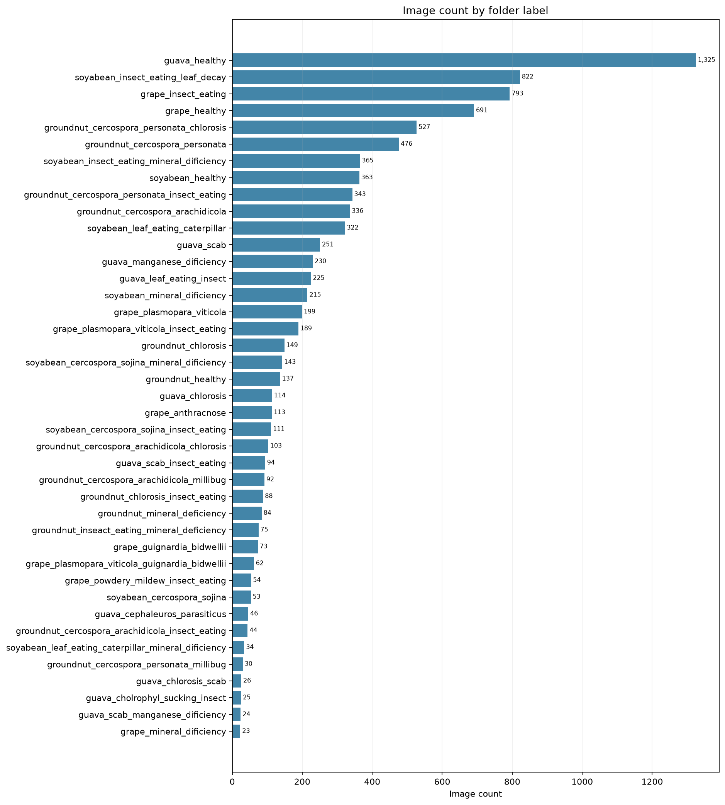
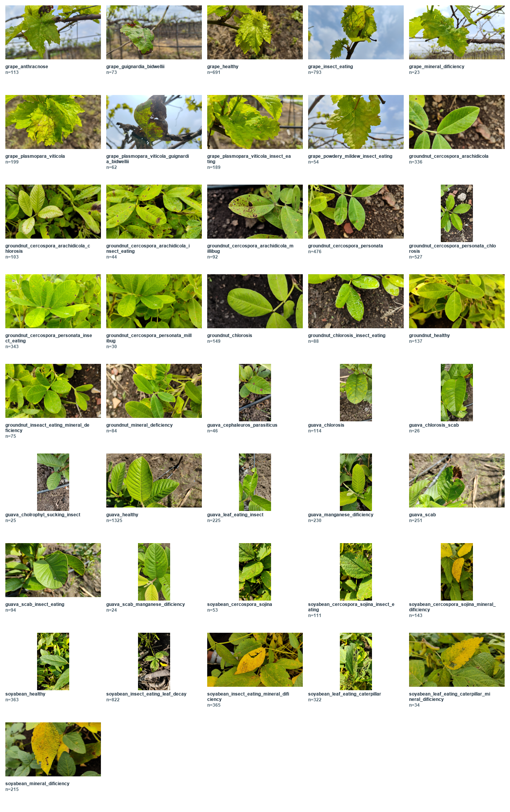

# Dataset and exploratory analysis

> **Key takeaways.** The inspected version 2 archive contains 9,469 JPGs in 41 combined species-condition folders; ten exact duplicate copies with conflicting labels were excluded from modeling.

Source: [Mendeley Data, version 2](https://data.mendeley.com/datasets/bsr2vzhrzr/2), DOI [10.17632/bsr2vzhrzr.2](https://doi.org/10.17632/bsr2vzhrzr.2). The project specification and bundled dataset README state CC BY 4.0. The archive README identifies itself as version 1.0, a source/version documentation mismatch. The archive has four species prefixes (grape, groundnut, guava, and source-spelled `soyabean`), but its labels are 41 folder-level combined categories rather than separate species and disease fields.

| Verified folder label | Raw images | Included after duplicate removal |
|---|---:|---:|
| `grape_anthracnose` | 113 | 113 |
| `grape_guignardia_bidwellii` | 73 | 73 |
| `grape_healthy` | 691 | 691 |
| `grape_insect_eating` | 793 | 793 |
| `grape_mineral_dificiency` | 23 | 23 |
| `grape_plasmopara_viticola` | 199 | 199 |
| `grape_plasmopara_viticola_guignardia_bidwellii` | 62 | 62 |
| `grape_plasmopara_viticola_insect_eating` | 189 | 189 |
| `grape_powdery_mildew_insect_eating` | 54 | 54 |
| `groundnut_cercospora_arachidicola` | 336 | 331 |
| `groundnut_cercospora_arachidicola_chlorosis` | 103 | 103 |
| `groundnut_cercospora_arachidicola_insect_eating` | 44 | 44 |
| `groundnut_cercospora_arachidicola_millibug` | 92 | 92 |
| `groundnut_cercospora_personata` | 476 | 471 |
| `groundnut_cercospora_personata_chlorosis` | 527 | 527 |
| `groundnut_cercospora_personata_insect_eating` | 343 | 343 |
| `groundnut_cercospora_personata_millibug` | 30 | 30 |
| `groundnut_chlorosis` | 149 | 149 |
| `groundnut_chlorosis_insect_eating` | 88 | 88 |
| `groundnut_healthy` | 137 | 137 |
| `groundnut_inseact_eating_mineral_deficiency` | 75 | 75 |
| `groundnut_mineral_deficiency` | 84 | 84 |
| `guava_cephaleuros_parasiticus` | 46 | 46 |
| `guava_chlorosis` | 114 | 114 |
| `guava_chlorosis_scab` | 26 | 26 |
| `guava_cholrophyl_sucking_insect` | 25 | 25 |
| `guava_healthy` | 1325 | 1325 |
| `guava_leaf_eating_insect` | 225 | 225 |
| `guava_manganese_dificiency` | 230 | 230 |
| `guava_scab` | 251 | 251 |
| `guava_scab_insect_eating` | 94 | 94 |
| `guava_scab_manganese_dificiency` | 24 | 24 |
| `soyabean_cercospora_sojina` | 53 | 53 |
| `soyabean_cercospora_sojina_insect_eating` | 111 | 111 |
| `soyabean_cercospora_sojina_mineral_dificiency` | 143 | 143 |
| `soyabean_healthy` | 363 | 363 |
| `soyabean_insect_eating_leaf_decay` | 822 | 822 |
| `soyabean_insect_eating_mineral_dificiency` | 365 | 365 |
| `soyabean_leaf_eating_caterpillar` | 322 | 322 |
| `soyabean_leaf_eating_caterpillar_mineral_dificiency` | 34 | 34 |
| `soyabean_mineral_dificiency` | 215 | 215 |

*Figure: Image counts by verified class. Source file: `../results/figures/class_distribution_counts.png`.*

*Figure: Representative samples from the dataset. Source file: `../results/figures/sample_images_by_class.png`.*

All 9,469 JPG files were fully decoded; none were unreadable. Exact duplicate checking used SHA-256 on image file bytes: five groups (ten files), each duplicated across two Groundnut folders with conflicting labels. Both copies from every group were excluded. SHA-256 will miss visually similar files encoded differently; no perceptual duplicate search was completed. No image-level plant, session, or group ID metadata was found. The dataset bundle does not include a separate resized training copy; dimensions vary, predominantly 2000x1126 and 634x1126. The full original class names and counts above preserve source spelling. The raw class max/min ratio was 57.6:1. The archive's Groundnut summary table omits a folder present in its folder tree and archive; Papaya is mentioned in the bundled crop notes but no Papaya class exists.
