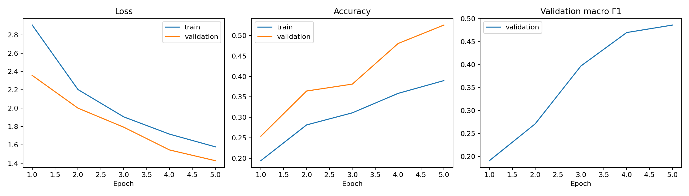
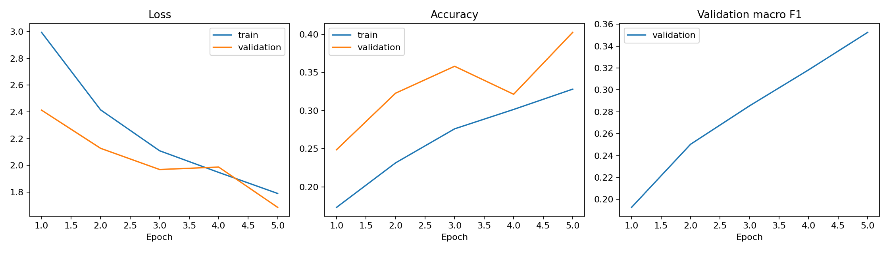
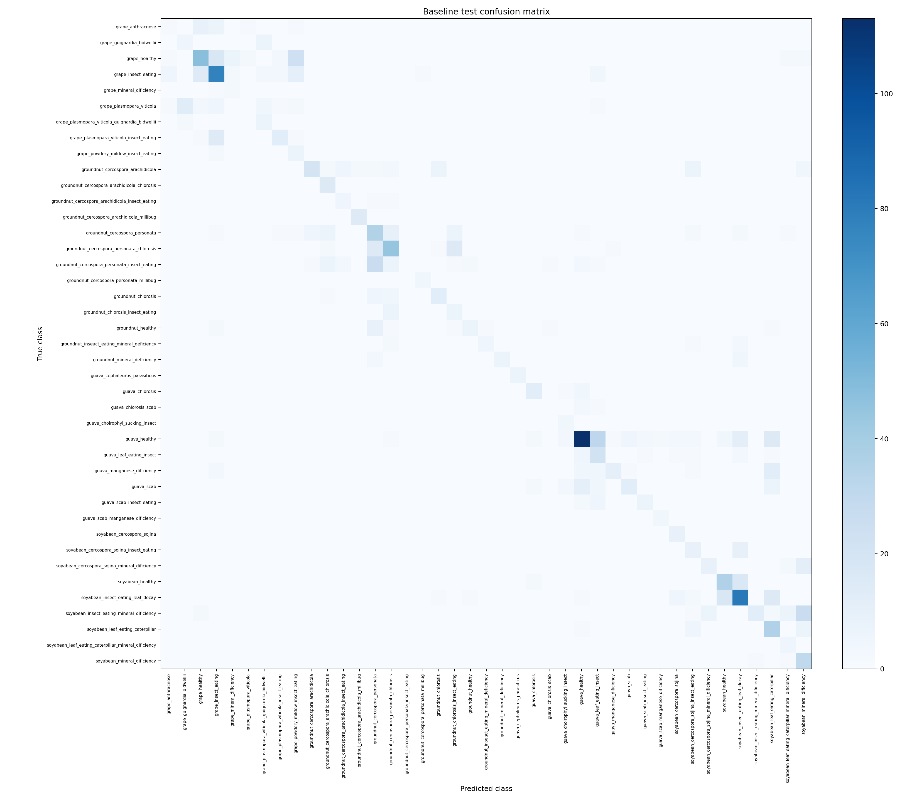

# Baseline CNN

> **Key takeaways.** The five-epoch no-augmentation CNN achieved 0.4918 test macro F1 after validation-only model selection; the short run was still improving at its final epoch.

The from-scratch baseline has four Conv2D (3x3)-BatchNorm-ReLU-MaxPool blocks with channels 16, 32, 64, and 96, followed by adaptive global average pooling, dropout (0.30), and a 41-class linear layer. Parameter count was 83,161; float32 parameter size was 0.317 MB.

| Layer | Configuration | Parameters |
|---|---|---:|
| Input | RGB 224x224 | - |
| Conv block 1 | Conv 3x3, 3->16; BatchNorm; ReLU; 2x2 max pool | 464 |
| Conv block 2 | Conv 3x3, 16->32; BatchNorm; ReLU; 2x2 max pool | 4,672 |
| Conv block 3 | Conv 3x3, 32->64; BatchNorm; ReLU; 2x2 max pool | 18,560 |
| Conv block 4 | Conv 3x3, 64->96; BatchNorm; ReLU; 2x2 max pool | 55,488 |
| Head | Global average pool; dropout 0.30; linear 96->41 | 3,977 |
| Total | Four convolutional blocks and classification head | 83,161 |

| Training setting | Value |
|---|---|
| Epochs | 5 per run; best epoch 5 |
| Batch size | 16 |
| Optimizer | AdamW |
| Learning rate / weight decay | 0.001 / 0.0001 |
| Imbalance handling | Inverse-frequency class weights |
| Seed / device | 42 / CUDA RTX 4050 |
| Model selection | Validation macro F1; test evaluated once after selection |

Both runs used seed 42, batch 16, AdamW, learning rate 0.001, weight decay 0.0001, class weights, and five epochs on RTX 4050 CUDA. The best checkpoint was selected by validation macro F1. The no-augmentation run reached 0.4863 validation macro F1 at epoch 5 in 786.5 seconds; the augmentation run reached 0.3525 at epoch 5 in 808.8 seconds.

*Figure: No-augmentation training and validation curves. Source file: `../results/loq_no_aug/training_curves.png`.*

*Figure: Augmented training and validation curves. Source file: `../results/loq_aug/training_curves.png`.*

The no-augmentation checkpoint was selected using validation macro F1 (0.4863) and evaluated once on the held-out test set (n=1419). Test accuracy was 0.5264, macro precision 0.5102, macro recall 0.5808, and macro F1 0.4918. Model-forward time was 2.554 ms/image on CUDA; full data loading and preprocessing pipeline time was 19.162 ms/image.

| Test class metrics | Precision | Recall | F1 | Support |
|---|---:|---:|---:|---:|
| Macro average | 0.510 | 0.581 | 0.492 | 1419 |

Full per-class results are listed below. The saved confusion matrix is a PNG; the evaluation did not export the raw cell counts, so the exact top confused class pairs are **NOT YET AVAILABLE**.

*Figure: One-time test confusion matrix for the validation-selected no-augmentation model. Source file: `../results/test_evaluation/confusion_matrix.png`.*

| Class | Precision | Recall | F1 | Test support |
|---|---:|---:|---:|---:|
| `grape_anthracnose` | 0.125 | 0.059 | 0.080 | 17 |
| `grape_guignardia_bidwellii` | 0.250 | 0.455 | 0.323 | 11 |
| `grape_healthy` | 0.632 | 0.462 | 0.533 | 104 |
| `grape_insect_eating` | 0.592 | 0.647 | 0.618 | 119 |
| `grape_mineral_dificiency` | 0.200 | 0.667 | 0.308 | 3 |
| `grape_plasmopara_viticola` | 0.000 | 0.000 | 0.000 | 30 |
| `grape_plasmopara_viticola_guignardia_bidwellii` | 0.350 | 0.778 | 0.483 | 9 |
| `grape_plasmopara_viticola_insect_eating` | 0.600 | 0.429 | 0.500 | 28 |
| `grape_powdery_mildew_insect_eating` | 0.136 | 0.750 | 0.231 | 8 |
| `groundnut_cercospora_arachidicola` | 0.769 | 0.400 | 0.526 | 50 |
| `groundnut_cercospora_arachidicola_chlorosis` | 0.469 | 1.000 | 0.638 | 15 |
| `groundnut_cercospora_arachidicola_insect_eating` | 0.385 | 0.714 | 0.500 | 7 |
| `groundnut_cercospora_arachidicola_millibug` | 0.875 | 1.000 | 0.933 | 14 |
| `groundnut_cercospora_personata` | 0.368 | 0.493 | 0.422 | 71 |
| `groundnut_cercospora_personata_chlorosis` | 0.570 | 0.570 | 0.570 | 79 |
| `groundnut_cercospora_personata_insect_eating` | 0.000 | 0.000 | 0.000 | 51 |
| `groundnut_cercospora_personata_millibug` | 0.800 | 1.000 | 0.889 | 4 |
| `groundnut_chlorosis` | 0.600 | 0.545 | 0.571 | 22 |
| `groundnut_chlorosis_insect_eating` | 0.226 | 0.538 | 0.318 | 13 |
| `groundnut_healthy` | 0.667 | 0.286 | 0.400 | 21 |
| `groundnut_inseact_eating_mineral_deficiency` | 0.833 | 0.455 | 0.588 | 11 |
| `groundnut_mineral_deficiency` | 1.000 | 0.462 | 0.632 | 13 |
| `guava_cephaleuros_parasiticus` | 1.000 | 1.000 | 1.000 | 7 |
| `guava_chlorosis` | 0.667 | 0.706 | 0.686 | 17 |
| `guava_chlorosis_scab` | 0.000 | 0.000 | 0.000 | 4 |
| `guava_cholrophyl_sucking_insect` | 0.364 | 1.000 | 0.533 | 4 |
| `guava_healthy` | 0.769 | 0.568 | 0.653 | 199 |
| `guava_leaf_eating_insect` | 0.301 | 0.647 | 0.411 | 34 |
| `guava_manganese_dificiency` | 0.833 | 0.286 | 0.426 | 35 |
| `guava_scab` | 0.667 | 0.316 | 0.429 | 38 |
| `guava_scab_insect_eating` | 0.636 | 0.500 | 0.560 | 14 |
| `guava_scab_manganese_dificiency` | 0.667 | 1.000 | 0.800 | 4 |
| `soyabean_cercospora_sojina` | 0.471 | 1.000 | 0.640 | 8 |
| `soyabean_cercospora_sojina_insect_eating` | 0.267 | 0.471 | 0.340 | 17 |
| `soyabean_cercospora_sojina_mineral_dificiency` | 0.571 | 0.381 | 0.457 | 21 |
| `soyabean_healthy` | 0.632 | 0.667 | 0.649 | 54 |
| `soyabean_insect_eating_leaf_decay` | 0.628 | 0.659 | 0.643 | 123 |
| `soyabean_insect_eating_mineral_dificiency` | 0.923 | 0.218 | 0.353 | 55 |
| `soyabean_leaf_eating_caterpillar` | 0.404 | 0.750 | 0.526 | 48 |
| `soyabean_leaf_eating_caterpillar_mineral_dificiency` | 0.294 | 1.000 | 0.455 | 5 |
| `soyabean_mineral_dificiency` | 0.380 | 0.938 | 0.541 | 32 |

Validation macro F1 and validation accuracy rose through epoch 5 for the no-augmentation run, and validation macro F1 rose each epoch for the augmented run. The five-epoch cap did not establish a plateau. The curves do not show a clear divergence within this short run, but they are insufficient to claim convergence.
