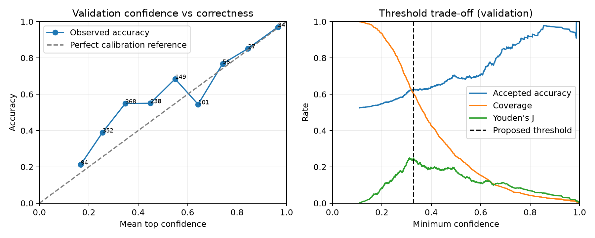

# Frontend

> **Key takeaways.** The Streamlit upload and result flow is implemented for the evolving FastAPI contract, with mock mode clearly marked and real predictions sourced only from the API.

The interface accepts JPG/JPEG/PNG files, checks that uploads can be decoded, previews the image, and sends it to `POST /predict`. It displays predicted class, confidence, optional status, and an optional Grad-CAM image or placeholder. Missing optional fields do not crash the display. Mock mode is controlled by `PLANTGUARD_MOCK_MODE=true` and prominently labels simulated output. The API base URL is read from `PLANTGUARD_API_BASE_URL`.

A validation-derived warning threshold of 0.328 is proposed. It maximizes Youden's J (0.249) for separating correct from incorrect validation predictions, subject to minimum support and coverage. At this cutoff, 858 of 1419 validation images (60.5%) were accepted, with 62.8% observed accuracy among accepted predictions. This remains a heuristic and does not make confidence a calibrated probability.

A screenshot was not supplied; insert an application screenshot here after backend integration. The disclaimer reads: AI prediction, not expert diagnosis. See `docs/api_contract.md` for the expected fields.

*Figure: Validation confidence compared with correctness and the selected cutoff. Source file: `../results/figures/validation_confidence_threshold.png`.*
