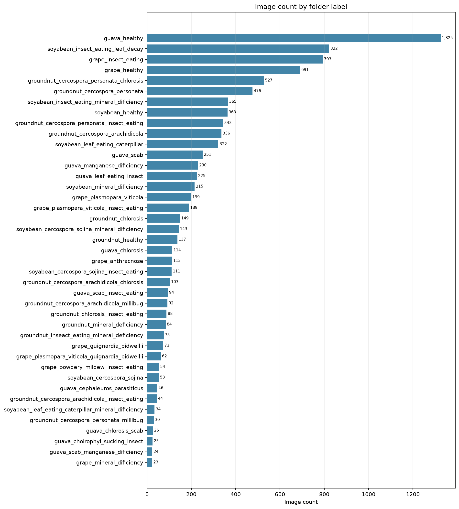
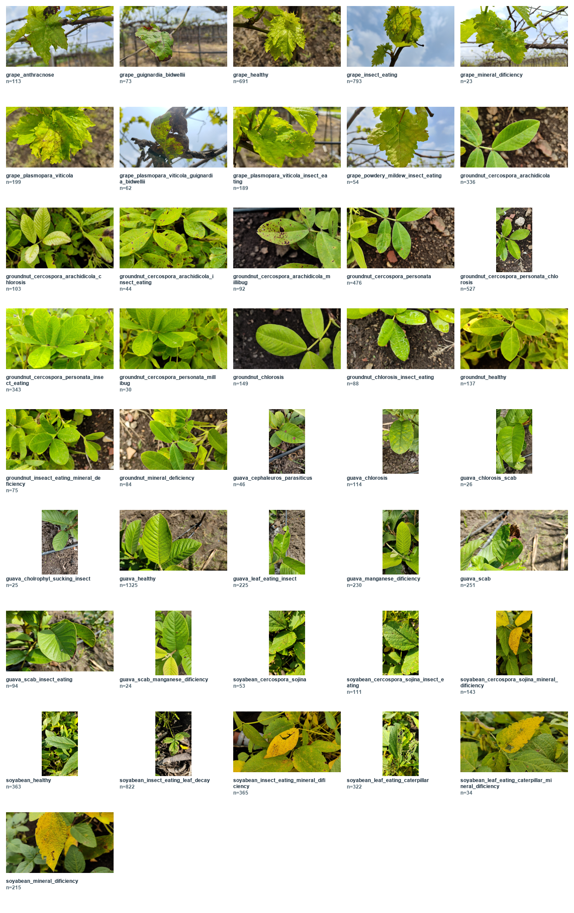
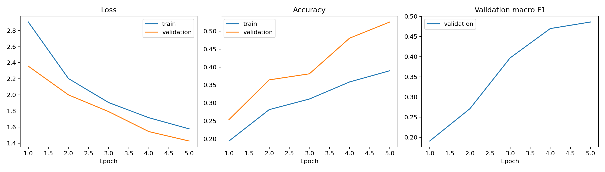
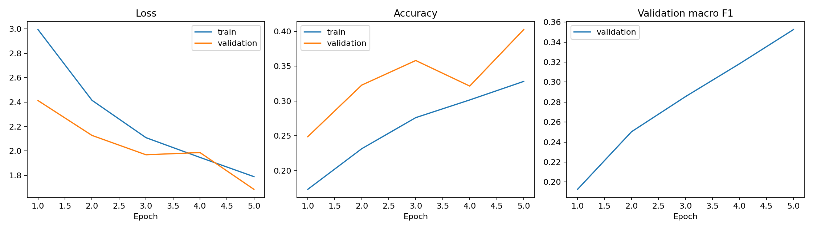
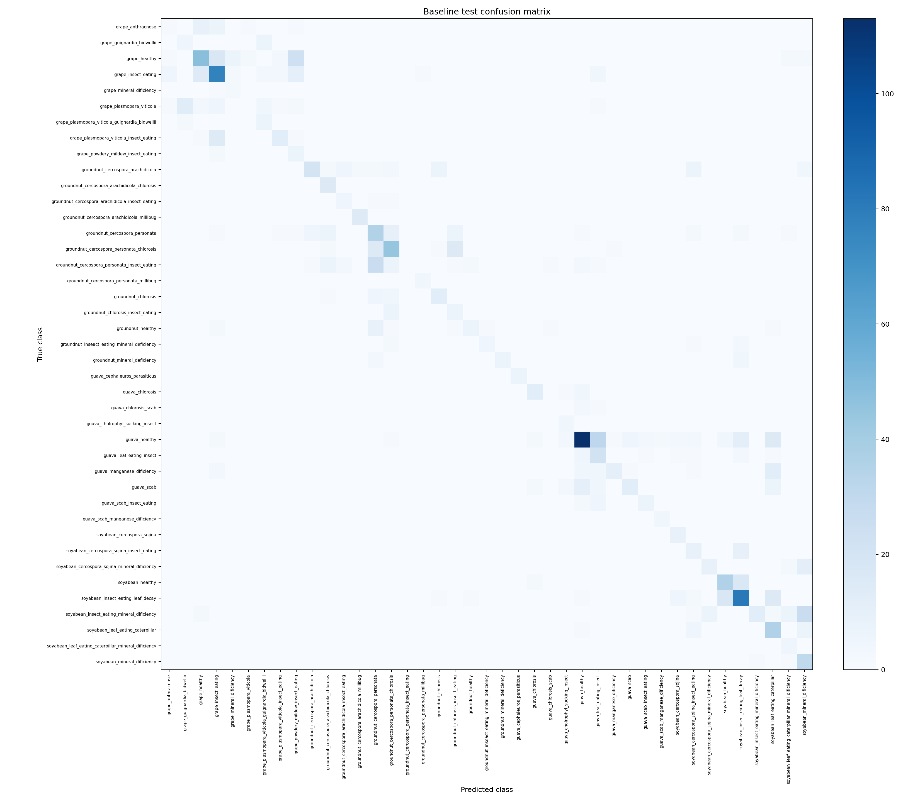
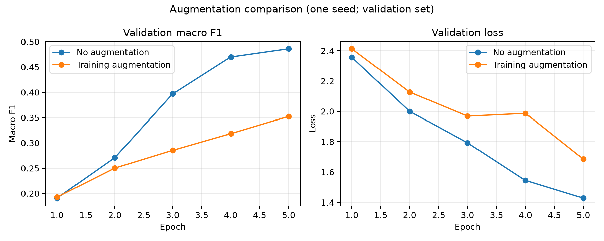

# PlantGuard AI: Maureen's Project Sections

# Contents

- Problem Background
- Dataset
- Preprocessing Split
- Baseline Cnn
- Augmentation Experiment
- Frontend
- Limitations Maureen

# Problem background

> **Key takeaways.** PlantGuard AI is an academic image-classification prototype for visible plant conditions; it is not expert diagnosis.

The project explores whether a leaf photograph can support a preliminary classification of plant and visible condition. Real-world appearance varies with lighting, background, and weather, while different conditions can look similar. The intended workflow is image upload, model inference, confidence display, and an optional visual explanation. The system must describe only classes represented by the verified dataset and must not imply that a Grad-CAM map precisely segments disease.

The team documentation describes transfer learning and a FastAPI application as project-wide goals. Maureen's completed work covers dataset preparation, a scratch CNN baseline, augmentation comparison, and a Streamlit frontend prepared for the API contract.

---

# Dataset and exploratory analysis

> **Key takeaways.** The inspected version 2 archive contains 9,469 JPGs in 41 combined species-condition folders; ten exact duplicate copies with conflicting labels were excluded from modeling.

Source: [Mendeley Data, version 2](https://data.mendeley.com/datasets/bsr2vzhrzr/2), DOI [10.17632/bsr2vzhrzr.2](https://doi.org/10.17632/bsr2vzhrzr.2). The project specification and bundled dataset README state CC BY 4.0. The archive README identifies itself as version 1.0, a source/version documentation mismatch. The archive has four species prefixes (grape, groundnut, guava, and source-spelled `soyabean`), but its labels are 41 folder-level combined categories rather than separate species and disease fields.

| Verified folder label | Raw images | Included after duplicate removal |
|---|---:|---:|
| `grape_anthracnose` | 113 | 113 |
| `grape_guignardia_bidwellii` | 73 | 73 |
| `grape_healthy` | 691 | 691 |
| `grape_insect_eating` | 793 | 793 |
| `grape_mineral_dificiency` | 23 | 23 |
| `grape_plasmopara_viticola` | 199 | 199 |
| `grape_plasmopara_viticola_guignardia_bidwellii` | 62 | 62 |
| `grape_plasmopara_viticola_insect_eating` | 189 | 189 |
| `grape_powdery_mildew_insect_eating` | 54 | 54 |
| `groundnut_cercospora_arachidicola` | 336 | 331 |
| `groundnut_cercospora_arachidicola_chlorosis` | 103 | 103 |
| `groundnut_cercospora_arachidicola_insect_eating` | 44 | 44 |
| `groundnut_cercospora_arachidicola_millibug` | 92 | 92 |
| `groundnut_cercospora_personata` | 476 | 471 |
| `groundnut_cercospora_personata_chlorosis` | 527 | 527 |
| `groundnut_cercospora_personata_insect_eating` | 343 | 343 |
| `groundnut_cercospora_personata_millibug` | 30 | 30 |
| `groundnut_chlorosis` | 149 | 149 |
| `groundnut_chlorosis_insect_eating` | 88 | 88 |
| `groundnut_healthy` | 137 | 137 |
| `groundnut_inseact_eating_mineral_deficiency` | 75 | 75 |
| `groundnut_mineral_deficiency` | 84 | 84 |
| `guava_cephaleuros_parasiticus` | 46 | 46 |
| `guava_chlorosis` | 114 | 114 |
| `guava_chlorosis_scab` | 26 | 26 |
| `guava_cholrophyl_sucking_insect` | 25 | 25 |
| `guava_healthy` | 1325 | 1325 |
| `guava_leaf_eating_insect` | 225 | 225 |
| `guava_manganese_dificiency` | 230 | 230 |
| `guava_scab` | 251 | 251 |
| `guava_scab_insect_eating` | 94 | 94 |
| `guava_scab_manganese_dificiency` | 24 | 24 |
| `soyabean_cercospora_sojina` | 53 | 53 |
| `soyabean_cercospora_sojina_insect_eating` | 111 | 111 |
| `soyabean_cercospora_sojina_mineral_dificiency` | 143 | 143 |
| `soyabean_healthy` | 363 | 363 |
| `soyabean_insect_eating_leaf_decay` | 822 | 822 |
| `soyabean_insect_eating_mineral_dificiency` | 365 | 365 |
| `soyabean_leaf_eating_caterpillar` | 322 | 322 |
| `soyabean_leaf_eating_caterpillar_mineral_dificiency` | 34 | 34 |
| `soyabean_mineral_dificiency` | 215 | 215 |

*Figure: Image counts by verified class. Source file: `../results/figures/class_distribution_counts.png`.*

*Figure: Representative samples from the dataset. Source file: `../results/figures/sample_images_by_class.png`.*

All 9,469 JPG files were fully decoded; none were unreadable. Exact duplicate checking used SHA-256 on image file bytes: five groups (ten files), each duplicated across two Groundnut folders with conflicting labels. Both copies from every group were excluded. SHA-256 will miss visually similar files encoded differently; no perceptual duplicate search was completed. No image-level plant, session, or group ID metadata was found. The dataset bundle does not include a separate resized training copy; dimensions vary, predominantly 2000x1126 and 634x1126. The full original class names and counts above preserve source spelling. The raw class max/min ratio was 57.6:1. The archive's Groundnut summary table omits a folder present in its folder tree and archive; Papaya is mentioned in the bundled crop notes but no Papaya class exists.

---

# Preprocessing and split

> **Key takeaways.** The 9,459-image modeling pool was stratified by its 41 exact labels into fixed 70/15/15 train, validation, and test CSVs; path and SHA-256 overlap were checked as zero.

Evaluation uses RGB, resize the shorter edge to 256, center crop to 224x224, then ImageNet mean/std normalization. The shared `models/preprocessing_config.json` remains 224x224. Training-only augmentation uses a mild 0.95-1.0 random scale crop, horizontal flip, and restrained color jitter; validation/test transforms do not augment. Horizontal flips preserve left/right orientation-independent leaf symptoms.

The split uses seed 42 and exact folder class stratification: 6,621 train, 1,419 validation, and 1,419 test images. The ten files in five exact duplicate groups were removed before splitting. Since the archive has no plant/session IDs, group-aware splitting was not possible; visually related but non-identical images may still cross splits. Inverse-frequency class weights were used in both full baseline runs.

---

# Baseline CNN

> **Key takeaways.** The five-epoch no-augmentation CNN achieved 0.4918 test macro F1 after validation-only model selection; the short run was still improving at its final epoch.

The from-scratch baseline has four Conv2D (3x3)-BatchNorm-ReLU-MaxPool blocks with channels 16, 32, 64, and 96, followed by adaptive global average pooling, dropout (0.30), and a 41-class linear layer. Parameter count was 83,161; float32 parameter size was 0.317 MB.

| Layer | Configuration | Parameters |
|---|---|---:|
| Input | RGB 224x224 | - |
| Conv block 1 | Conv 3x3, 3->16; BatchNorm; ReLU; 2x2 max pool | 464 |
| Conv block 2 | Conv 3x3, 16->32; BatchNorm; ReLU; 2x2 max pool | 4,672 |
| Conv block 3 | Conv 3x3, 32->64; BatchNorm; ReLU; 2x2 max pool | 18,560 |
| Conv block 4 | Conv 3x3, 64->96; BatchNorm; ReLU; 2x2 max pool | 55,488 |
| Head | Global average pool; dropout 0.30; linear 96->41 | 3,977 |
| Total | Four convolutional blocks and classification head | 83,161 |

| Training setting | Value |
|---|---|
| Epochs | 5 per run; best epoch 5 |
| Batch size | 16 |
| Optimizer | AdamW |
| Learning rate / weight decay | 0.001 / 0.0001 |
| Imbalance handling | Inverse-frequency class weights |
| Seed / device | 42 / CUDA RTX 4050 |
| Model selection | Validation macro F1; test evaluated once after selection |

Both runs used seed 42, batch 16, AdamW, learning rate 0.001, weight decay 0.0001, class weights, and five epochs on RTX 4050 CUDA. The best checkpoint was selected by validation macro F1. The no-augmentation run reached 0.4863 validation macro F1 at epoch 5 in 786.5 seconds; the augmentation run reached 0.3525 at epoch 5 in 808.8 seconds.

*Figure: No-augmentation training and validation curves. Source file: `../results/loq_no_aug/training_curves.png`.*

*Figure: Augmented training and validation curves. Source file: `../results/loq_aug/training_curves.png`.*

The no-augmentation checkpoint was selected using validation macro F1 (0.4863) and evaluated once on the held-out test set (n=1419). Test accuracy was 0.5264, macro precision 0.5102, macro recall 0.5808, and macro F1 0.4918. Model-forward time was 2.554 ms/image on CUDA; full data loading and preprocessing pipeline time was 19.162 ms/image.

| Test class metrics | Precision | Recall | F1 | Support |
|---|---:|---:|---:|---:|
| Macro average | 0.510 | 0.581 | 0.492 | 1419 |

Full per-class results are listed below. The saved confusion matrix is a PNG; the evaluation did not export the raw cell counts, so the exact top confused class pairs are **NOT YET AVAILABLE**.

*Figure: One-time test confusion matrix for the validation-selected no-augmentation model. Source file: `../results/test_evaluation/confusion_matrix.png`.*

| Class | Precision | Recall | F1 | Test support |
|---|---:|---:|---:|---:|
| `grape_anthracnose` | 0.125 | 0.059 | 0.080 | 17 |
| `grape_guignardia_bidwellii` | 0.250 | 0.455 | 0.323 | 11 |
| `grape_healthy` | 0.632 | 0.462 | 0.533 | 104 |
| `grape_insect_eating` | 0.592 | 0.647 | 0.618 | 119 |
| `grape_mineral_dificiency` | 0.200 | 0.667 | 0.308 | 3 |
| `grape_plasmopara_viticola` | 0.000 | 0.000 | 0.000 | 30 |
| `grape_plasmopara_viticola_guignardia_bidwellii` | 0.350 | 0.778 | 0.483 | 9 |
| `grape_plasmopara_viticola_insect_eating` | 0.600 | 0.429 | 0.500 | 28 |
| `grape_powdery_mildew_insect_eating` | 0.136 | 0.750 | 0.231 | 8 |
| `groundnut_cercospora_arachidicola` | 0.769 | 0.400 | 0.526 | 50 |
| `groundnut_cercospora_arachidicola_chlorosis` | 0.469 | 1.000 | 0.638 | 15 |
| `groundnut_cercospora_arachidicola_insect_eating` | 0.385 | 0.714 | 0.500 | 7 |
| `groundnut_cercospora_arachidicola_millibug` | 0.875 | 1.000 | 0.933 | 14 |
| `groundnut_cercospora_personata` | 0.368 | 0.493 | 0.422 | 71 |
| `groundnut_cercospora_personata_chlorosis` | 0.570 | 0.570 | 0.570 | 79 |
| `groundnut_cercospora_personata_insect_eating` | 0.000 | 0.000 | 0.000 | 51 |
| `groundnut_cercospora_personata_millibug` | 0.800 | 1.000 | 0.889 | 4 |
| `groundnut_chlorosis` | 0.600 | 0.545 | 0.571 | 22 |
| `groundnut_chlorosis_insect_eating` | 0.226 | 0.538 | 0.318 | 13 |
| `groundnut_healthy` | 0.667 | 0.286 | 0.400 | 21 |
| `groundnut_inseact_eating_mineral_deficiency` | 0.833 | 0.455 | 0.588 | 11 |
| `groundnut_mineral_deficiency` | 1.000 | 0.462 | 0.632 | 13 |
| `guava_cephaleuros_parasiticus` | 1.000 | 1.000 | 1.000 | 7 |
| `guava_chlorosis` | 0.667 | 0.706 | 0.686 | 17 |
| `guava_chlorosis_scab` | 0.000 | 0.000 | 0.000 | 4 |
| `guava_cholrophyl_sucking_insect` | 0.364 | 1.000 | 0.533 | 4 |
| `guava_healthy` | 0.769 | 0.568 | 0.653 | 199 |
| `guava_leaf_eating_insect` | 0.301 | 0.647 | 0.411 | 34 |
| `guava_manganese_dificiency` | 0.833 | 0.286 | 0.426 | 35 |
| `guava_scab` | 0.667 | 0.316 | 0.429 | 38 |
| `guava_scab_insect_eating` | 0.636 | 0.500 | 0.560 | 14 |
| `guava_scab_manganese_dificiency` | 0.667 | 1.000 | 0.800 | 4 |
| `soyabean_cercospora_sojina` | 0.471 | 1.000 | 0.640 | 8 |
| `soyabean_cercospora_sojina_insect_eating` | 0.267 | 0.471 | 0.340 | 17 |
| `soyabean_cercospora_sojina_mineral_dificiency` | 0.571 | 0.381 | 0.457 | 21 |
| `soyabean_healthy` | 0.632 | 0.667 | 0.649 | 54 |
| `soyabean_insect_eating_leaf_decay` | 0.628 | 0.659 | 0.643 | 123 |
| `soyabean_insect_eating_mineral_dificiency` | 0.923 | 0.218 | 0.353 | 55 |
| `soyabean_leaf_eating_caterpillar` | 0.404 | 0.750 | 0.526 | 48 |
| `soyabean_leaf_eating_caterpillar_mineral_dificiency` | 0.294 | 1.000 | 0.455 | 5 |
| `soyabean_mineral_dificiency` | 0.380 | 0.938 | 0.541 | 32 |

Validation macro F1 and validation accuracy rose through epoch 5 for the no-augmentation run, and validation macro F1 rose each epoch for the augmented run. The five-epoch cap did not establish a plateau. The curves do not show a clear divergence within this short run, but they are insufficient to claim convergence.

---

# Augmentation experiment

> **Key takeaways.** With one seed and five epochs, validation macro F1 was lower in the augmented run; this is a preliminary single-run observation, not a general conclusion.

Both runs used the same 41-class mapping, fixed split, BaselineCNN, seed 42, five epochs, batch size 16, AdamW (lr 0.001, weight decay 0.0001), inverse-frequency class weights, and RTX 4050 CUDA. Training augmentation was the intended variable.

| Run | Best validation macro F1 | Best epoch | Train + validation time |
|---|---:|---:|---:|
| No augmentation | 0.4863 | 5 | 786.5 s |
| Training augmentation | 0.3525 | 5 | 808.8 s |

The observed validation difference (augmentation minus no augmentation) was -0.1338 macro F1 in this single seed and five-epoch run. This is descriptive, not evidence that augmentation generally helps or hurts. Both runs reached their best validation score at the final epoch and were still improving, so the epoch limit did not establish convergence. No additional training was started.

Test-set evaluation was performed once, after choosing the no-augmentation checkpoint by validation macro F1. Its metrics are recorded separately in `results/test_evaluation/metrics.json`; they are not a second augmentation comparison because the augmented model was not selected for test evaluation.

The results table and plot use validation metrics for both runs. The held-out test set was used once for the validation-selected no-augmentation checkpoint only; no test score is reported for the augmented run.

*Figure: Validation macro F1 and loss for the augmentation comparison. Source file: `../results/figures/augmentation_comparison.png`.*

---

# Frontend

> **Key takeaways.** The Streamlit upload and result flow is implemented for the evolving FastAPI contract, with mock mode clearly marked and real predictions sourced only from the API.

The interface accepts JPG/JPEG/PNG files, checks that uploads can be decoded, previews the image, and sends it to `POST /predict`. It displays predicted class, confidence, optional status, and an optional Grad-CAM image or placeholder. Missing optional fields do not crash the display. Mock mode is controlled by `PLANTGUARD_MOCK_MODE=true` and prominently labels simulated output. The API base URL is read from `PLANTGUARD_API_BASE_URL`.

The confidence threshold is **NOT YET AVAILABLE** because validation predictions have not yet been generated from the selected checkpoint. `scripts/propose_confidence_threshold.py` derives it from validation only; the UI reads the value from `frontend/confidence_config.json`.

A screenshot was not supplied; insert an application screenshot here after backend integration. The disclaimer reads: AI prediction, not expert diagnosis. See `docs/api_contract.md` for the expected fields.

---

# Limitations (Maureen's work)

> **Key takeaways.** Results are limited by the source labels, severe class imbalance, lack of group metadata, one random seed, and a short scratch-CNN run.

The 41 labels combine species and conditions and retain source spelling errors; the model cannot produce separate species and disease outputs without additional verified annotations. The folder names do not provide validated disease ground truth beyond the dataset's labeling. Class frequencies range widely, including small classes with limited test support.

No plant/session grouping metadata was supplied, so residual leakage among related but non-identical images is possible. Only one split and seed were used. The baseline is a small CNN trained for five epochs, and its validation scores were still increasing at the final epoch. The reported test metrics apply to one checkpoint selected by validation macro F1. No robustness evaluation, external field validation, or multi-seed uncertainty analysis is included. Confidence values are not calibrated probabilities. The frontend is contract-ready but has not been integrated with Disca's real backend.
