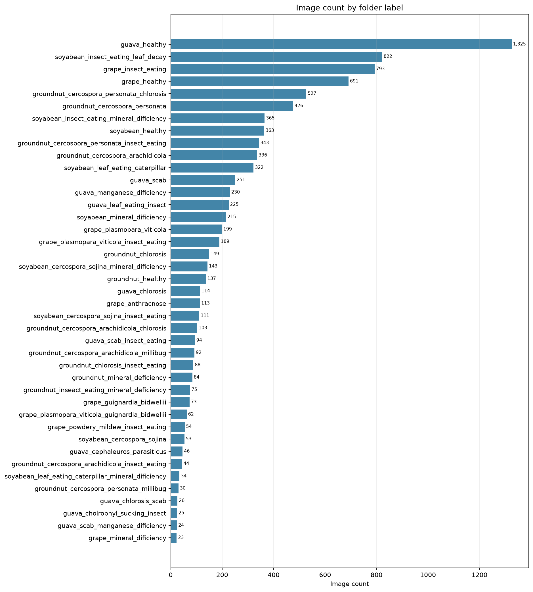
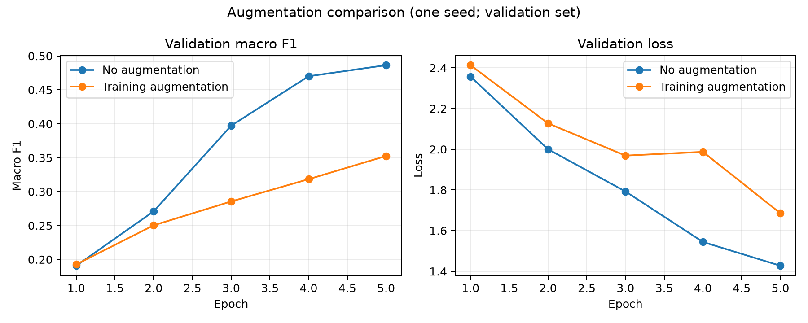
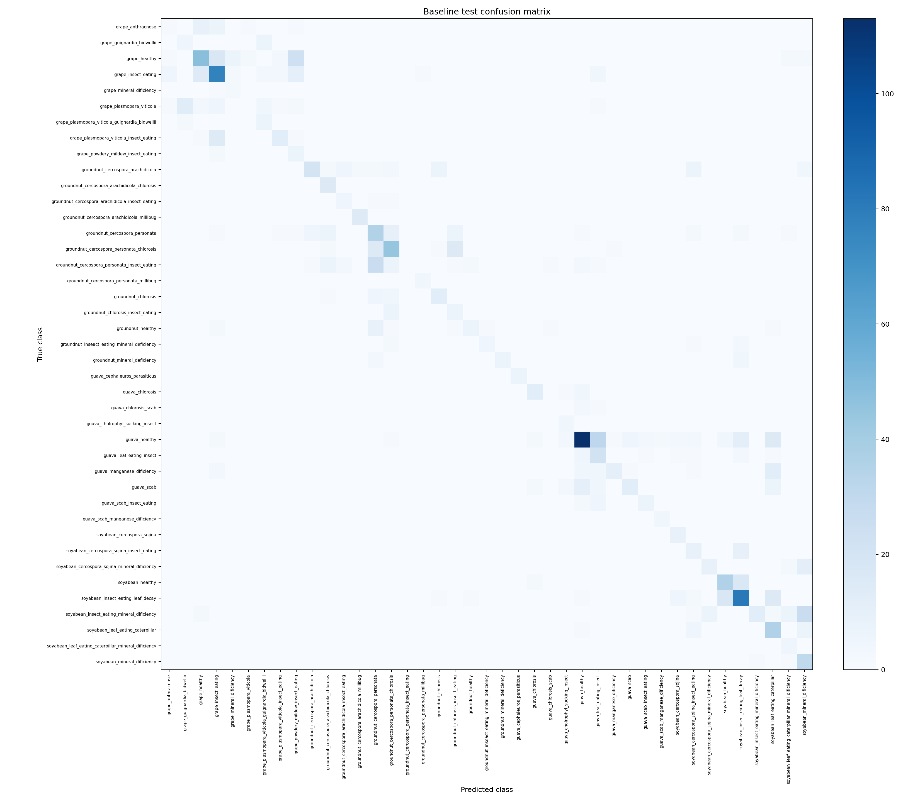
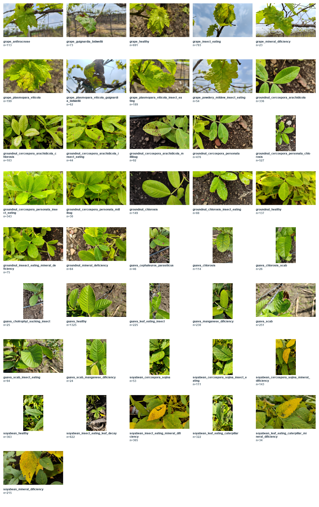

# Maureen's results summary

## Key findings

- Verified archive: 9,469 images, 41 combined folder labels; five exact duplicate pairs were dropped in full, leaving 9,459 images.
- Fixed stratified split: 6,621 train / 1,419 validation / 1,419 test. Path and SHA-256 overlap: zero.
- Best validation run: no augmentation, macro F1 0.4863 at epoch 5; augmented run 0.3525 at epoch 5.
- Validation-selected no-augmentation test result (evaluated once): accuracy 0.5264; macro precision 0.5102; macro recall 0.5808; macro F1 0.4918.
- The five-epoch runs were still improving at the last epoch; one seed is not enough to generalize the augmentation comparison.

## Main comparison

| Experiment | Best validation macro F1 | Test macro F1 |
|---|---:|---:|
| No augmentation | 0.4863 | 0.4918 |
| Training augmentation | 0.3525 | Not evaluated (test reserved for selected model) |

## Figures

Detailed metrics: `results/experiment_results.csv`, `results/test_evaluation/metrics.json`, and `results/test_evaluation/classification_report.csv`.
